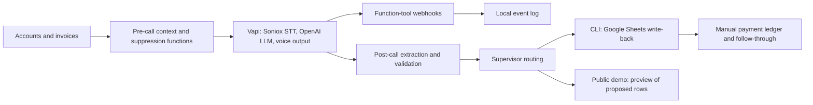

Voice-agent production review and portfolio improvement plan

Reviewed 15 October 2026, for a product manager role building voice AI agents.

Scope: local repository at `784aaf7`, saved simulation results, historical evaluation artifacts, demo source, and current primary-source documentation. This is a code and evidence review; the live deployment and portfolio website were not inspected. No paid model calls or full test-suite reruns were performed. Five small offline checks reproduced the defects described below. This document proposes changes; it does not change the application, prompts, scenarios, labels, or infrastructure.

**Important correction to the existing evidence**

During this review, the project owner confirmed that the nine historical calls were labeled randomly across multiple parameters. All human-agreement metrics derived from `fixtures/eval/labels.json` are therefore invalid as evidence of accuracy or safety. This includes outcome agreement, promise/dispute/compliance agreement, write-decision agreement, and the previously displayed false-write/false-hold counts. Those counts measure disagreement with unreliable labels, not actual mistakes by the system. My initial interpretation of them as safety findings is withdrawn.

The transcripts and cached pipeline responses can be retained for debugging. Archive the original labels with an explicit invalidation reason; do not silently edit them until the scores look better. The demo Evals tab, README, and `docs/eval.md` should replace their nine-call performance claims with “Historical labels invalidated; benchmark being rebuilt.” Confidence thresholds must not be calibrated on this dataset. A proposed replacement rubric is in `EVAL_LABELING_RUBRIC_V2.md`.

**Overall assessment**

This is a substantial working prototype with a strong workflow thesis and real failure analysis. It does not yet demonstrate reliable unattended production operation. The strongest next step is a small, observable workflow that reliably completes actions, handles failure, and measures its outcomes. That will demonstrate voice-AI PM judgment more convincingly than an expanded feature list.

Current architecture:



These components exist, but their production integration is incomplete. In particular, the test-call entry point supplies empty history, several tools only log events, and the public demo previews rather than executes CRM write-back.

**What already works, and what the evidence supports**

| Area | Existing strength | Evidence boundary |
|---|---|---|
| Product scope | Primary-invoice focus; no negotiation of discounts; human escalation for older debt; payment promises distinguished from vague commitments | Several policies are instructions or pure functions rather than enforced across every runtime path |
| Context assembly | Typed account/invoice objects, deterministic primary selection, spoken-number rendering, separate raw references for tools | History and freshness need integration; current caller-identity check is conversational |
| Voice implementation | Managed Vapi pipeline; Soniox transcription; language configuration; customized interruption/backchannel behavior; duration cap; tool-wait messages | Existing latency comparison is one control call per model, not a production distribution |
| Post-call processing | Five parallel specialist tasks; deterministic amount/date checks; disagreement and compliance routing; summary | Validation gaps and uncalibrated self-reported confidence remain |
| Persistence code | Separate Sheets adapter, deterministic per-call write-back IDs, stale-record reconciliation | Sequential rerun safety does not establish atomicity or concurrent deduplication |
| Evaluation | 349 tests passed in the last run on 14 October; real-prompt text simulation; expected and forbidden tool assertions | Unit tests validate coded behavior, not the validity of product definitions; human benchmark invalidated |
| Portfolio experience | Live/replay console, tool traces, specialist results, downloadable synthetic write-back example, prompt visibility, incident explanations | Live CRM writes, operator resolution, and fresh evaluation evidence are not demonstrated |

Saved 14 October simulation results remain reportable as harness results:

| Model playing the agent | Scenarios passing every must-have | Failed checks | Reported API spend |
|---|---:|---:|---:|
| gpt-4o-mini | 18/21 | 4 | $0.0515 |
| gpt-4o | 17/21 | 5 | $0.3780 |

Each was one text-only run with a simulated customer. These are not production success rates, voice-quality scores, or a reliable model ranking. The earlier 11/21 baseline used different matching and simulator behavior, so the apparent improvement cannot all be credited to agent improvements. Preserve evaluator versions alongside results.

**Production comparison and prioritized defects**

| Priority | Finding | Specific improvement | Evidence that the improvement works |
|---|---|---|---|
| P0 | Historical human benchmark is invalid | Withdraw its public metrics; define a rubric; rebuild labels from distinct, reviewed cases | Versioned labels with evidence spans, reviewer IDs, and adjudication notes |
| P0 | `mark_opt_out` returns confirmed after writing only a JSONL event | Persist contact/account suppression immediately, independently of post-call confidence | Opt out, restart, attempt another dispatch: call remains blocked |
| P0 | Callback, document, and payment-claim handlers return success/IDs without durable work records | Create durable tasks with owner, status, reason, due time, and idempotency key; distinguish accepted/queued/completed | A callback survives restart and can be assigned, completed, or marked failed |
| P0 | Tools accept model-supplied identifiers without a call-bound authorization check | Resolve account/contact from authenticated call context; validate invoice ownership and allowed actions server-side | Wrong-account IDs and pre-verification lookups are rejected even if the model requests them |
| P0 | Promise validation accepts negative amounts; live and post-call same-day rules differ | Require positive finite amounts; use decimal/minor units; unify date/timezone policy; return canonical invoice IDs | Negative, zero, excessive, ambiguous, wrong-account, and date-boundary cases fail consistently |
| P0 | Payment follow-through can count money received before a promise and reuse one payment for multiple promises | Introduce unique payment IDs and explicit allocation to obligations/promises, a balance snapshot, and reversal handling | Prior payments and duplicate events do not inflate fulfillment or recovery |
| P1 | Suppression/history functions are not wired through the main test-call path | Load call history, promises, disputes, opt-outs, and latest balances before prioritization and again before dispatch | Prior promise/cooldown/dispute fixtures change the actual queue and rendered context |
| P1 | Expected actions still rely on model memory | Track call state and required actions; reconcile missing actions; avoid closing as completed until receipts exist | Timeout, correction, and multi-invoice cases produce the correct final state |
| P1 | Text simulation omits actual speech and telephony behavior | Add controlled audio tests and a small consented human-call test set | Critical entities, response delay, interruption recovery, and call completion measured on audio |
| P1 | End-of-call processing uses process-local background tasks | Persist received events before acknowledging; use retryable jobs with deduplication and a failed-job queue | Kill the process after receipt: processing resumes without duplicate writes |
| P1 | Free-host config stores logs/session budget in ephemeral files | Use durable storage; verify deployed configuration; serve a reliable cached demo | Budget and task state survive redeploy; idle visitor gets a useful immediate page |
| P1 | Public replay triggers fresh paid analysis without the live-call availability checks | Cache approved replay outputs by input/config version; gate deliberate refreshes and enforce backend quotas | Repeated anonymous replay requests do not cause repeated model spend |
| P1 | No application-level alerting/release gates were found | Correlate call/turn/tool/job IDs; add health and quality monitors; version releases and demonstrate rollback | An injected failure raises a useful alert and links to its trace |
| P2 | Human escalation is a callback request, not a demonstrated completed handoff | Build an operator task view first; add warm transfer only if the workflow requires immediate assistance | A real operator receives context; failed/unanswered transfer has an explicit fallback |

Source anchors: `webhooks/handlers.py:37,62,108,114,120`; `webhooks/server.py:76,81,149`; `cli.py:233,236,252`; `postcall/specialists/promise.py:83,91,107`; `followthrough/job.py:47,73`; `webhooks/demo_replay.py:405,491,506`; `webhooks/demo_live.py:242,286`; `render.yaml:23,57` (all Python paths relative to `src/collections_agent/`).

The offline checks reproduced:

```text
Payment before promise captured -> kept
One payment reused for two promises -> ['kept', 'kept']
Negative promise amount -> within_outstanding: True downgraded: False
Claim check: I'll arrange for a follow-up. Please expect a call from our team soon. -> passed: True
Claim check: I have scheduled a callback. [only previous tool was a rejected dispute] -> passed: True
```

These are synthetic reproductions of implementation defects, not incidents involving real customer money.

**Prompt and conversation review**

The prompt has useful specificity: the account's facts, explicit refusal boundaries, separate questions for promise details, use of information already provided, and success-before-confirmation instructions. Retain those choices.

1. Resolve branch ambiguity. In both saved runs, “I never received the invoice; email me a copy” triggers `send_document`, but the evaluator expects `log_dispute`. The prompt's document branch also supports requesting the document. Define the business policy explicitly: for example, record an invoice-not-received issue and create a document request, without implying every document request is a dispute. Version that policy and its tests together; preserve old results.
2. Separate intent from completion. “I'll arrange a follow-up” and “your callback is scheduled” are different claims. Specify what the agent may say while gathering details, what requires a durable receipt, and how it explains rejection. The current failure message says the action will be confirmed in writing even when no confirmed follow-up task exists; align this with actual capabilities.
3. Reduce spoken overhead. Both latest models passed the per-scenario 25-word check on only 4/21 cases, despite the scorer excluding supplied facts. Measure spoken seconds and unnecessary repetition, then test a shorter account introduction. A word-count heuristic alone does not establish a natural call.
4. Protect information before verification. The deterministic opening mentions an overdue invoice before the recipient confirms identity. The wrong-person test excludes the opening. Use a neutral opening, a risk-appropriate verification policy, and release sensitive context/tools only after that policy succeeds. A name-confirmation question is not strong authentication.
5. Track state explicitly. Suggested states: unverified, authorized, primary issue identified, promise details pending, confirmation pending, action accepted, follow-up pending, closed. Opt-out and wrong-party handling override the normal route. Let the model phrase the conversation while server-side state controls action permissions and durable records.
6. Make spoken output match reality. The opening says recording may occur while audio recording is disabled in the configured demo; transcripts are still stored. Align the disclosure with actual retention and use. Distinguish “request queued” from “document sent.”
7. Keep English as the validated scope until Hindi has end-to-end evidence. Voice configuration alone does not validate transcription, entity extraction, policy adherence, or downstream classifiers in Hindi.

These security recommendations follow least-privilege and untrusted-content boundaries, rather than relying exclusively on prompt wording. Vapi supports server-controlled static parameters; OWASP explicitly notes that RAG does not eliminate prompt injection. [Vapi static parameters](https://docs.vapi.ai/tools/static-variables-and-aliases/static-parameters), [OWASP prompt injection](https://genai.owasp.org/llmrisk/llm01-prompt-injection/).

**Retrieval: improve the current data path first**

The application currently assembles structured CRM context and exposes an invoice lookup. That is appropriate for exact balances, invoice identifiers, prior promises, and opt-outs. Semantic document search is an optional extension for policies and supporting documents.

| Information | Retrieval strategy | Required controls |
|---|---|---|
| Balance, invoice status, payment receipts | Exact database/API lookup scoped to the authenticated account | Canonical IDs, ownership checks, `as_of`, currency, freshness, source record version |
| Prior promises, disputes, contact history | Bounded structured history assembled before the call | Recent relevant records, unresolved status, source timestamps, no empty placeholder history |
| Document request eligibility | Exact invoice/document association | Access scope, document type, delivery destination verification, request status |
| Policies and approved FAQs | Curated search when needed | Document version, effective date, account/tenant scope, source ID, explicit no-answer behavior |

Build a data contract containing raw values, spoken values, provenance, freshness, and permitted uses. Revalidate dynamic balances before writing a commitment. If lookup fails or data is stale, avoid guessing and create a durable follow-up.

Raw free-text dispute details are currently interpolated into the system prompt. Treat CRM notes and retrieved documents as untrusted data; separate them from instructions and minimize their ability to influence tools. Source: `voice/prompt_template.py:95`.

Retrieval evaluation should measure correct record selection, wrong-account exposure, stale-data handling, required-fact completeness, refusal on missing information, and lookup latency. For policy search, add passage relevance and answer grounding. Vapi provides both document Query tools and custom retrieval integration, so choose an extension only when a real question requires it. [Query tool](https://docs.vapi.ai/knowledge-base/using-query-tool), [custom retrieval](https://docs.vapi.ai/knowledge-base/custom-knowledge-base).

**Evaluation: establish trustworthy measurement before optimizing scores**

There are three independent objects to evaluate: the agent, the simulated customer, and the grader.

- Simulator validity: the `two_invoices_promise_primary` customer brief says to pay the first invoice raised. In both saved runs the customer instead refuses that invoice's confirmed amount. Treat this as a potentially invalid generated test, subject to explicit adjudication. Do not pressure the agent to record an unconfirmed promise just to satisfy the original expected action.
- Grader validity: the action-claim check accepts any previous action tool, even an unrelated failed one. It also misses “I'll arrange a follow-up.” Check action identity, success result, target record, time ordering, and final durable state. Use carefully calibrated semantic judgment only where deterministic evidence cannot answer the question.
- Outcome vs wording: production's payment reference included `UTR number` before the correct identifier. Preserve raw evidence, normalize only approved prefixes, and confirm the receiving integration's contract. This is different from incorrect payment digits.
- Conditional reporting: post-call scores currently exclude agent-failed scenarios. Keep that diagnostic view, but also report an end-to-end denominator that includes all valid eligible scenarios. Report simulator-invalid and infrastructure-error cases separately and visibly.
- Reproducibility: save code SHA, rendered prompt hash, tool schema hash, scenario/evaluator version, model and configuration, date/timezone, input snapshot, and token usage. Current artifacts do not capture a complete experiment manifest.
- Spending: `ensure_room` uses estimated input and 500 output tokens without passing a matching output limit to the model request. Post-call costs are checked before a parallel batch and recorded afterward. The current “hard cap” claim is stronger than the implementation guarantees. Add bounded outputs, reservations for concurrent calls, conservative token accounting, retry accounting, and fail-closed handling of missing usage. Preserve the existing user budgets.

Proposed test layers:

| Layer | Cases to add | Evidence produced |
|---|---|---|
| Deterministic contracts | Money, dates, canonical IDs, authorization, idempotency, payment allocation | Fast CI failures, no model spend |
| Fixed-turn decisions | Already paid vs future promise; document vs dispute; missing-reference callback | Reproducible tool-choice and state assertions |
| Whole conversations | Corrections, multi-invoice ambiguity, refusal, opt-out, language mismatch | Task/state completion plus valid-simulator flag |
| Audio | Indian accents, lakh/crore, dates and UTR spelling, noise, pauses, interruptions, short “stop” | Critical-entity accuracy, turn timing, interruption recovery |
| Failure recovery | Slow tools, lost/duplicate webhooks, provider failure, process restart, disconnect during a write | Durable state, recovery duration, duplicate-write count |
| Human review | Distinct calls, explicit rubric, evidence spans, adjudicated disagreements | A defensible benchmark and calibrated grading |

Start with roughly 12–15 deliberately different canonical cases as a manageable annotation set, then expand to a held-out set across speakers and conditions. Repeated runs should have an explicitly approved spend budget. Keep critical safety cases as release gates; never let an average score conceal them. This is a proposed evaluation design, not a claim that this sample size proves production reliability.

Vapi distinguishes text Evals from whole-conversation simulations, and voice mode exercises speech and turn-taking; even voice simulation needs controlled calls to validate the real phone/integration path. [Evals quickstart](https://docs.vapi.ai/observability/evals-quickstart), [Simulations quickstart](https://docs.vapi.ai/observability/simulations-quickstart).

**Revised metrics: fix definitions before adding charts**

Recommended product outcome: collected cash against a fixed cohort of eligible outstanding balances, within a declared window. Keep promise fulfillment as an intermediate metric. In a pilot, compare randomized eligible account groups or another explicitly justified control design to estimate incremental effect. A prototype should show synthetic calculations as synthetic and mark real business impact as unmeasured.

| Existing metric | Problem or limit | Proposed change |
|---|---|---|
| `calls_made` | Based on post-call records; may omit failed attempts or analysis failures | Count provider attempt events; show dialed, answered, right-party verified, completed, and analyzed separately |
| `calls_suppressed` | Hardcoded zero because queue logging is absent | Show “not instrumented” until suppression decisions are persisted, with reason and account/day deduplication |
| `contact_rate` | Includes wrong-party and hostile pickups | Retain as human-answer rate; add right-party contact rate with a stated denominator |
| `structured_outcome_rate` | Excludes only no-answer/hostile/wrong-person; a classification is not proof of action completion | Add verified workflow-completion rate using scenario-specific required durable actions |
| `promise_to_pay_kept_rate` | Underlying status can reuse old payments; open/unprocessed promises disappear from the denominator | Fix allocation; report due, evaluated, fulfilled, partial, broken, and evaluation backlog; publish coverage beside the rate |
| `promise_to_pay_kept_rate_by_value` | Weights fully kept promises; excludes partial recovery from the numerator | Label it value-weighted full-fulfillment rate; separately report actual allocated cash / matured promised amount, capped per obligation |
| `human_review_rate` | Divides exceptions created that day by calls made that day; dates can represent different cohorts | Join by call ID and cohort; separate review-required, reviewed, overdue, and review minutes |
| Human agreement / false writes | Random historical labels invalidate the benchmark | Withdraw until re-annotation; then report field precision/recall and safe-write precision under a documented policy |
| Specialist confidence / QA score | Model self-report, not calibrated correctness probability | Show as an internal signal; assess calibration against valid reviewed cases before choosing thresholds |
| Mean latency from one call/model | Too little evidence and hides slow tails | Report per-turn p50/p95 with sample size, provider/config version, and separately labeled tool/no-tool turns |

No-data and not-instrumented are different from zero. Display `N/A` with the reason when denominators are empty. All charts should show the numerator, denominator, time window, experiment/config version, and data source.

Proposed operating scorecard:

| Metric | Definition / evidence |
|---|---|
| Eligible-cohort recovery | Allocated payments received in 14/30 days / eligible outstanding at cohort start; cap and deduplicate allocations |
| Incremental recovery | Difference in the same pre-defined outcome between treatment and control; only after a real pilot |
| Promise fulfillment | Fully fulfilled matured promises / evaluated matured promises; display evaluation coverage and grace-window policy |
| Verified workflow completion | Valid eligible conversations whose required actions reached accepted durable states / valid eligible conversations; split by intent |
| Safe-write precision | Human-adjudicated correct and permitted proposed writes / reviewed proposed writes; keep follow-up need separate |
| Human operations | Review minutes, review backlog age, callback completion within SLA, dispute resolution time |
| Safety | Counts and opportunities for wrong-party disclosure, opt-out persistence failure, unauthorized actions, and false completion claims |
| Voice experience | End-of-user-speech to first audible response p50/p95, interruption yield/recovery, critical-entity accuracy, repetition and abandonment |
| System reliability | Tool success/timeout, end-of-call receipt, analysis completion, duplicate side effects, task age, restart recovery |
| Unit economics | Total telephony/STT/LLM/TTS/platform/post-call/retry cost per verified outcome, plus human review cost; full cohort costs include failed attempts |

Measure the actual response interval rather than adding overlapping streaming stages blindly. Keep component timings to diagnose the total: endpointing, STT, model, tool, and TTS. LiveKit's published metrics make this distinction explicit. [Per-turn metrics](https://docs.livekit.io/agents/ops/logging/), [trace stages](https://docs.livekit.io/reference/agents/session-traces/).

For initial alert design, treat any confirmed wrong-account disclosure or repeated opt-out failure as requiring immediate investigation; use rates plus counts for routine timeout/latency changes. Establish latency targets from actual calls and user tolerance, rather than presenting an invented universal SLA. Review some unflagged calls too. Vapi monitors can evaluate configured conditions and notify operators; they do not establish coverage for unknown failures. [Monitoring quickstart](https://docs.vapi.ai/observability/monitoring-quickstart).

**Production architecture and release discipline**

Keep the managed voice stack while making application responsibilities explicit: call-bound context and permissions; validated commands; durable task/event storage; asynchronous CRM processing; human review; and payment reconciliation. A smaller reliable architecture is enough to demonstrate ownership of the full lifecycle.

Add an event ledger with `call_id`, `turn_id`, `tool_call_id`, `account_id`, context version, config version, timestamps, requested/accepted/completed/failed status, and source-of-truth receipt. Do not use client-supplied fallback transcripts as authoritative evidence for production writes. The current browser fallback is appropriate only for its explicitly synthetic demo scope.

Use at-least-once processing with idempotent effects and reconciliation. Test out-of-order delivery and concurrent duplicates. Do not assume that a request timeout means the downstream action never happened. Vapi documents this distinction and different retry paths for different tool types. [Tool reliability](https://docs.vapi.ai/tools/api-request/reliability).

Add CI for deterministic tests; a versioned small release eval; staging configuration; a deployment manifest; dependency/readiness checks; rollback and a dispatch kill switch. Plan STT/TTS/model failure handling and an explicit end/callback fallback. Measure short stop requests under the existing interruption settings; do not infer safety from a three-word threshold. [Turn-taking tuning](https://docs.livekit.io/agents/logic/turns/tuning/).

The checked-in Render plan is free with local SQLite. Current Render documentation says idle free services spin down and local filesystem changes are lost across restart/redeploy/spindown. This threatens both first-visit experience and persistent budget/task tracking if the deployment matches the file. Verify actual hosted configuration before claiming the issue is occurring live. [Render free-service behavior](https://render.com/docs/free).

Retained transcripts and raw webhook logs need access restrictions, redaction, retention/deletion rules, and an accurate user disclosure even with audio recording disabled. For a customer pilot, document the target jurisdiction, calling permissions, identity policy, and approved compliance review; this audit does not establish legal compliance.

**Portfolio presentation for a voice-AI PM role**

The strongest story is: choose a business problem, define acceptable automation, instrument the workflow, expose failures, make a measured change, and verify what improved.

The current demo already has a good narrative structure. Update its evidence instead of adding decorative complexity:

1. Show the current scope prominently: synthetic B2B collections data; live voice and saved replay; English end-to-end validation status.
2. Show one successful journey from account context to a persisted promise and uniquely allocated payment.
3. Show one failure journey: slow tool or ambiguous commitment, accurate customer communication, durable human task, operator resolution, safe retry.
4. Add an evaluation panel with separate cards for deterministic tests, text simulations, audio tests, and reviewed labels. Invalidate the old nine-call card immediately; show honest pending states for new work.
5. Add a trace view linking speech, retrieved facts, tool arguments/result, written record, post-call judgment, and cost.
6. Add a compact operator queue with transcript evidence, editable proposed fields, approval reason, owner, SLA, and audit history. This demonstrates the difference between AI output and an operational product.
7. Publish two decision records: why exact CRM retrieval suits balances, and why the selected model meets measured quality/latency/cost requirements. A one-run 18/21 versus 17/21 result is not a model-selection conclusion.
8. Publish the label-invalidation lesson honestly: an ambiguous and rushed annotation process produced untrustworthy metrics; the replacement uses a clear rubric and reviewed evidence. This is a useful PM learning when followed by correction.

Suggested implementation order:

| Milestone | Scope | Visible proof |
|---|---|---|
| 1. Trustworthy evidence | Withdraw invalid metrics; create rubric and distinct canonical cases; test the grader; version manifests | An honest scorecard and inspectable labels |
| 2. Reliable workflow | Persist opt-out/callback/document tasks; validate positive amounts/account scope; fix payment allocation; connect history | A restart/duplicate demo plus accurate metric arithmetic |
| 3. Voice quality and operations | Small audio matrix; latency traces; failure injection; operator review; budget persistence | A trace, alert, operator resolution, and measured audio result |
| 4. Product experiment | Baseline and a single targeted change; fixed evaluation set plus holdout; approved spend | Before/after quality and cost with clear limitations |
| 5. Pilot readiness | Scoped live integrations, operational ownership, jurisdiction review, and outcome cohort design | A credible launch plan with release and rollback criteria |

A real bank integration, multilingual expansion, warm transfer, and alternative voice-stack experiments can follow evidence of need. For the upcoming PM interview, prioritize an explainable and reliable complete journey, a defensible evaluation, and metrics that reflect actual outcomes.

Implementation follow-up: [status, operating instructions and verification](IMPLEMENTATION_STATUS_2026-10-15.md). This audit preserves its original findings; consult the implementation record for changes made afterward and remaining gaps.
